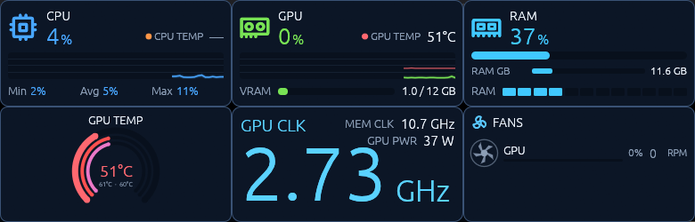
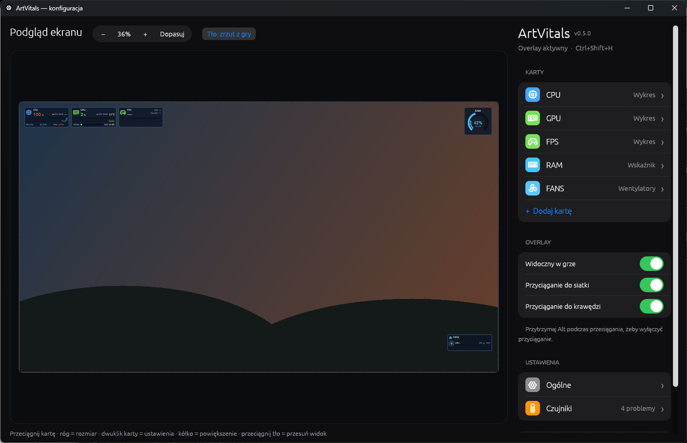

<div align="center">

# ArtVitals

**A lightweight in-game hardware and frame-rate overlay for Windows.**
CPU · GPU · RAM · FPS & 1% lows · fans & AIO

[](https://github.com/nirrar/ArtVitals/releases/latest)
[](#requirements)
[](https://www.rust-lang.org)
[](LICENSE)

[Download](https://github.com/nirrar/ArtVitals/releases/latest) ·
[Features](#features) ·
[Supported hardware](#supported-hardware) ·
[FAQ](#faq) ·
[Building](#building-from-source)



</div>

---

ArtVitals draws translucent stat cards on top of your game. The overlay **never captures your
mouse or keyboard** and **never injects into the game process** - it is a plain transparent,
always-on-top window, so it stays out of your way and out of anti-cheat's way.
Everything is configured in a separate settings window, outside the game.

Sensors are built in - no need to keep MSI Afterburner, HWiNFO or LibreHardwareMonitor running.
The whole thing is **a single portable exe**, no installer.

## Features

| Feature | Details |
|---|---|
| **Cards** | line graph with history, gauge with rings, bar, big number, and a fans card with spinning rotors |
| **Frame metrics** | FPS, average FPS, 1% low, 0.1% low and a frame-by-frame frame time graph - DirectX 9-12, Vulkan and OpenGL |
| **Sensors** | load, temperatures (incl. GPU hotspot and memory junction), clocks, power draw, VRAM, RAM, fan speeds, AIO pump and liquid temperature |
| **Extra metrics** | add readings from the same component to any card: as a line on the graph, a separate mini graph or a plain value |
| **Look** | color thresholds (smooth fade to yellow and red), per-card accent and background color, opacity, text size boost up to +10 pt |
| **Settings window** | full-screen preview with zoom, grid and edge snapping; **use a game screenshot as the background** to place cards around your HUD |
| **Global hotkeys** | show/hide the overlay and the settings window - record them or build them from modifiers |
| **Language** | English and Polish, picked automatically from the Windows display language |
| **Portable** | config and log live next to the exe (when the folder is writable) - carry it on a USB stick |

<div align="center">

<br><sub>Settings window: full-screen preview with a game screenshot as the background, cards on the right.</sub>
</div>

## Supported hardware

| Component | What is read | Source |
|---|---|---|
| **NVIDIA GPU** (GTX 10, RTX 20/30/40/50) | load, temperature, hotspot, memory temp (GDDR6X/GDDR7), clocks, power, fan % and RPM, VRAM | NVML + NVAPI from the driver |
| **AMD Radeon GPU** | load, temperature, hotspot, memory temp, clocks, power, fan % and RPM, VRAM | ADL from the driver |
| **Intel GPU** (Arc, integrated) | load, temperature, clocks, power, fan, VRAM (Arc) | IGCL from the driver |
| **Intel CPU** | load, clock, package temperature, package power | PDH + PawnIO |
| **AMD CPU** (Ryzen, Threadripper; older FX/Phenom/APU - temperature only) | load, clock, Tctl/Tdie temperature, package power | PDH + PawnIO |
| **Motherboard fans** (Nuvoton NCT67xx/NCT668x, ITE IT86xx/IT87xx) | speed of every header, including an AIO pump plugged into the board | Super I/O via PawnIO |
| **USB AIO coolers** (NZXT Kraken X/Z/2023/Elite, Corsair Commander Core/ST) | pump, fans, liquid temperature | USB HID |
| **Game** | FPS, average FPS, 1% / 0.1% lows, frame time | ETW (like PresentMon) |

> [!NOTE]
> AMD, Intel Arc, RTX 20/30 and AIO support is ported from mature open-source projects, but not
> every configuration has been verified on real hardware yet. If something reads wrong,
> [open an issue](https://github.com/nirrar/ArtVitals/issues) with your `overlay.log` and hardware model.

## Requirements

- **Windows 10 or 11** (64-bit).
- Games in **borderless window** mode - exclusive fullscreen hides every other window, including the overlay.
- The [**PawnIO**](https://pawnio.eu) driver - for CPU temperature/power and motherboard fans.
- **Run as administrator** - needed for PawnIO and frame metrics.
  Everything else works without it, and missing readings are explained in the **Sensors** window.

## Installation

1. Download `ArtVitals-<version>-portable.zip` from [Releases](https://github.com/nirrar/ArtVitals/releases/latest).
2. Extract it to any folder (e.g. `D:\Tools\ArtVitals`).
3. Run `art_vitals.exe` - ideally with **right click → Run as administrator**.

The settings window opens on first launch. Later, open it with the hotkey (default **Ctrl+Shift+O**)
or a left click on the tray icon. **Ctrl+Shift+H** shows and hides the overlay.

> [!TIP]
> To line cards up with your game's HUD: take a screenshot in game (**PrintScreen** or **Win+Shift+S**),
> then in the settings window pick **Background: game screenshot → Paste from clipboard**.

### Where settings are stored

| File | Location |
|---|---|
| `config.toml` | next to `art_vitals.exe`; if that folder isn't writable (e.g. Program Files) - `%APPDATA%\ArtVitals` |
| `overlay.log` | same folder as `config.toml` |
| preview background | `preview-background.*` next to `config.toml` |

`config.toml` can be edited by hand - the app reloads it as soon as you save.

## FAQ

<details>
<summary><b>Is it safe with anti-cheat?</b></summary>

ArtVitals doesn't inject code into games, doesn't hook DirectX and doesn't read game memory.
Frame metrics come from system ETW events (the same way Intel's PresentMon works), and the overlay
is an ordinary topmost window. CPU and motherboard readings go through the signed PawnIO driver
(also used by LibreHardwareMonitor and FanControl).
</details>

<details>
<summary><b>I can't see the overlay in game.</b></summary>

Switch the game to **borderless window** mode. In exclusive fullscreen Windows doesn't show any
window on top of the game.
</details>

<details>
<summary><b>FPS shows "—".</b></summary>

Frame metrics require running as administrator. The game with the active window is measured -
click into it if it was in the background a moment ago.
</details>

<details>
<summary><b>CPU temperature or motherboard fans are missing.</b></summary>

Install [PawnIO](https://pawnio.eu) and run ArtVitals as administrator. The **Sensors** window
in the settings shows what is missing and why.
</details>

<details>
<summary><b>Which fan in the list is my pump?</b></summary>

Motherboards report headers as "Fan 1, 2, 3…". The fans card settings show the live speed of each
one (a pump usually spins at 2000-3000 RPM) - give it your own name, e.g. "AIO pump", and hide
unused headers.
</details>

## Building from source

You need [Rust](https://rustup.rs) (stable, 2024 edition) and Visual Studio Build Tools (MSVC).

```powershell
git clone https://github.com/nirrar/ArtVitals.git
cd ArtVitals
cargo build --release           # target\release\art_vitals.exe (no console window)
cargo build                     # debug build (with a console window)
cargo test                      # unit tests
cargo clippy --all-targets      # lint - must pass with no warnings
```

### Architecture

| Module | Role |
|---|---|
| `src/main.rs` | startup: single instance lock, logger, overlay window (eframe, glow renderer) |
| `src/config.rs` | `config.toml` model, validation, migrations, portable config folder |
| `src/i18n.rs` | Polish/English strings (`tr`), Windows language detection |
| `src/metrics.rs` | metric catalog (names, units, ranges, thresholds, component) |
| `src/widgets.rs` | card rendering on the egui painter |
| `src/icons.rs` | Phosphor icons (font) |
| `src/sensors/` | sensor thread: PDH, PawnIO (Intel/AMD CPU), NVML + NVAPI / ADL / IGCL (GPU), ETW (FPS), RAM |
| `src/sensors/fans/` | motherboard fans (Super I/O) and AIO coolers (USB HID) |
| `src/overlay/app.rs` | app: overlay, saving, hotkeys, tray |
| `src/overlay/settings.rs` | settings window (screen preview, side panel, sheets) |
| `src/overlay/screenshot.rs` | game screenshot as the preview background (file, clipboard) |
| `src/overlay/ui_kit.rs` | settings window controls |
| `src/overlay/win32.rs` | Windows window fixes (layered window, DWM frame, capture for blur) |

Developer notes (in Polish, also for AI assistants working on the code): [AI_CONTEXT.md](AI_CONTEXT.md).
Changelog: [CHANGELOG.md](CHANGELOG.md).

## Roadmap

- [ ] Start with Windows (as administrator, via Task Scheduler)
- [ ] More metrics: disks, network
- [ ] Session recording (benchmark) to CSV with an FPS and lows summary
- [ ] Per-game card layouts
- [ ] Version metadata in the exe

Part of the **ArtCraft** family of projects (alongside Artcord), built with the help of AI.

## License

ArtVitals is licensed under the [Mozilla Public License 2.0](LICENSE).

Third-party assets and code it builds on:

- [Phosphor](https://phosphoricons.com) icons (Bold) - MIT, `assets/Phosphor.LICENSE.txt`
- `IntelMSR.bin`, `AMDFamily17.bin`, `AMDFamily10.bin`, `AMDFamily0F.bin`, `LpcIO.bin` modules from
  [PawnIO.Modules](https://github.com/namazso/PawnIO.Modules) (release 0.2.12) - LGPL-2.1,
  `assets/<module>.LICENSE.txt`
- AMD CPU, NVAPI, AMD GPU (ADL), Intel GPU (IGCL), Super I/O fan (Nuvoton, ITE) and NZXT Kraken
  readings based on [LibreHardwareMonitor](https://github.com/LibreHardwareMonitor/LibreHardwareMonitor)
  (MPL-2.0); older AMD temperatures also follow the Linux `k10temp` driver
- Struct layouts from the [AMD Display Library SDK](https://github.com/GPUOpen-LibrariesAndSDKs/display-library) (MIT)
- Struct layouts and constants from the [Intel Graphics Control Library](https://github.com/intel/drivers.gpu.control-library)
  header `igcl_api.h` - Copyright (C) Intel Corporation, Intel Software License Agreement (use on Intel
  platforms only; the Intel GPU backend talks to `ControlLib.dll` on Intel GPUs only), `assets/IGCL.LICENSE.txt`
- ETW event identifiers based on [PresentMon](https://github.com/GameTechDev/PresentMon) (MIT)
- Corsair Commander Core protocol as described in the [liquidctl](https://github.com/liquidctl/liquidctl) documentation
- [hidapi](https://github.com/ruabmbua/hidapi-rs) crate (MIT, with the C hidapi library under the BSD/HIDAPI license)
